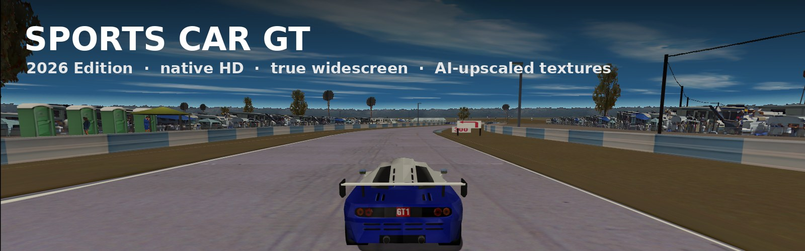
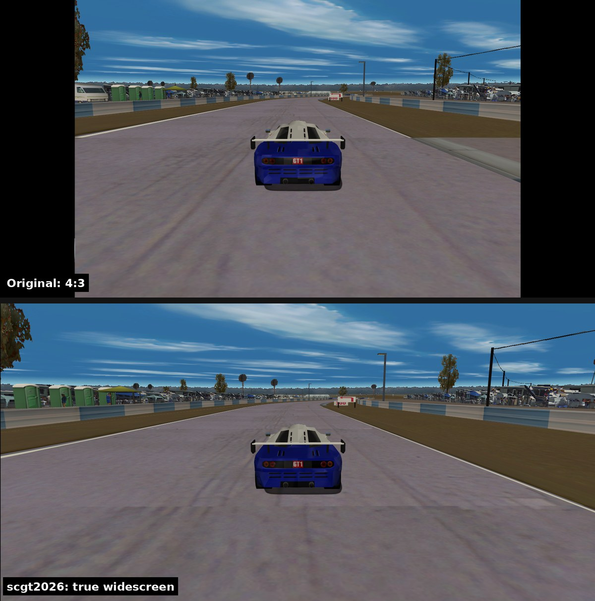
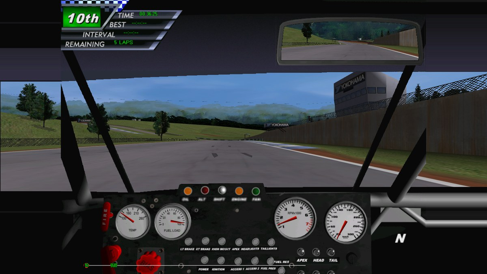
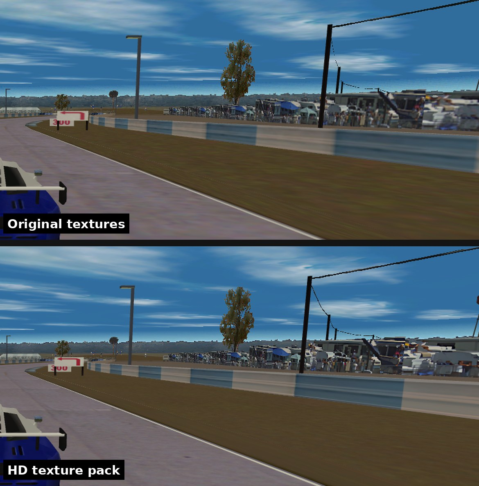
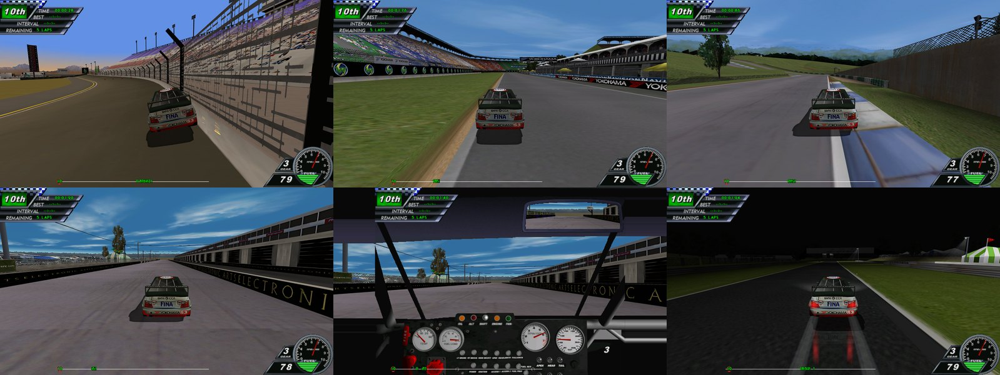

# Sports Car GT: 2026 Edition

**Sports Car GT** is the GT racing sim Image Space Incorporated made for Electronic Arts in 1999. This project brings the PC version (1.551) to modern Windows in native HD and true widescreen, with AI-upscaled textures — the same idea as [4x4 Evolution: 2026 Edition](https://github.com/antonflor/4x4-Evo-2026-Recomp).

The heart of it is **scgt2026**, a renderer written for this game. It replaces the game's 3dfx Glide driver (`glide2x.dll`) and draws with Direct3D 9. The exe isn't changed on disk. It adds:

- native-resolution output (1080p, 1440p, 4K) in a borderless window
- true widescreen (Hor+), with the race HUD at the screen edges
- a widescreen cockpit: the dash stays as drawn, its roof and door panel continue to the screen edges, the side windows open onto the wider view
- HD texture replacement in 32-bit colour, with a full AI-upscaled pack for every car and track
- 4× MSAA, 16× anisotropic filtering, trilinear filtering, vsync

## Screenshots

All captured from the game running on scgt2026 at 1600×900 (Sebring and Road Atlanta).

### Widescreen

The extra width shows more of the track at the sides. Nothing is stretched; the HUD moves out to the edges.



### Cockpit

The dash view in widescreen. The gauges, needles, gear readout and mirror stay exactly where the cockpit art puts them.



### HD textures

The same replay frame with the original textures and with the HD pack (zoomed in): sharper walls, signs and track-side detail.



### Tracks



## How it works

| Piece | What it is |
|---|---|
| `Spcar.exe` | The game, 32-bit, 1.551. It has two renderers: 3dfx Glide 2 (loaded at runtime from `glide2x.dll`) and Direct3D 6 |
| `glide2x.dll` (scgt2026) | All 121 Glide 2 functions the game resolves, on Direct3D 9: an uber-shader for Glide's colour/alpha/texture combiners, the W-buffer and fog table, colour keying, emulated texture memory, and exact emulation of the frame buffer the game writes its menus, movies and cockpit into |
| `MAS\*.MAS` | ISI archives: car shapes and liveries, track shapes and textures, menus, fonts, the cockpit. Format documented in [`tools/mas.py`](tools/mas.py) |

- **Resolution.** Glide hands over every vertex already in screen space, so the renderer simply draws the game's 640×480 (or 800×600, 1024×768) frame at the monitor's resolution. 3D is rasterized at full detail; frame-buffer art (menus, movies, cockpit) is scaled with filtering.
- **Widescreen.** The game's view setup (`View::SetFov`) is hooked in memory: full-screen views get a wider horizontal field of view, the same vertical one (Hor+), and the renderer spreads that view across the screen. Smaller views (the rear-view mirror) keep theirs. The 2D layer stays 4:3; in races its blocks are anchored to the nearest screen edge. The hook checks the exact code bytes of 1.551 and leaves any other build in 4:3.
- **Cockpit.** The dash view is a 640×480 cockpit image the game writes into the frame buffer — most of it once, the windshield frame every frame. The renderer recognises it, keeps it and everything on it in the 4:3 area, and extends its outer columns (from `DASH.MAS`) into the side areas: the roof and door panel continue, the side-window band stays open onto the wider 3D view.
- **HD textures.** Every texture upload is identified by a CRC of the bytes the game uploads; `textures\<crc>.png` replaces it at any size, in 32-bit colour, compressed to DXT in memory (the game is 32-bit, and a grid of HD cars plus a track would otherwise run it out of address space).

## Install

Download **`SportsCarGT2026-Kit-v1.0.0.zip`** from the [latest release](../../releases/latest), unzip it next to your Sports Car GT CD folder (or mount the ISO), and double-click **Install Sports Car GT 2026.cmd**. It installs the game from your disc to `C:\Games\Sports Car GT`, applies the official 1.551 patch, and adds the renderer and the HD textures. Full instructions and settings: [`dist/README.md`](dist/README.md).

Already installed? `glide2x.dll` from the release is the renderer on its own: drop it into the game folder to update.

## Build

```
make            # needs i686-w64-mingw32-g++ (Linux/WSL: apt install g++-mingw-w64-i686)
make shaders    # only after editing renderer/shaders.hlsl (runs fxc through Wine)
```

Output: `build/glide2x.dll`. Then `python tools/make_kit.py <kit> --game "<installed game>" --textures <pack> --patch Patch-1551a.zip` assembles the install kit.

## HD texture workflow

```
pip install torch --index-url https://download.pytorch.org/whl/cu128   # NVIDIA GPU; CPU works too
pip install pillow numpy

python tools\mas_textures.py export "C:\Games\Sports Car GT" textures_original
python tools\upscale_textures.py textures_original textures_hd
python tools\mas_textures.py glide "C:\Games\Sports Car GT" textures_hd "C:\Games\Sports Car GT\textures"
```

- `--match Cmaps/01` does one car (car #01), `--match SEBAMAP` one track.
- `--model x4plus` for the sharper, heavier model. `--reuse <earlier output>` redoes only the post-processing.
- Menus, fonts, loading screens and the dash are skipped by default (the game ships one image per screen resolution for those); `--include-ui` includes them.
- Cut-outs (wheel arches, trees, fences, flags, spectators) use pure magenta as the transparency key: it's filled with neighbouring colours before upscaling, so it can't bleed into the edges, and rebuilt at the new size with smooth edges.
- Surfaces whose fine noise the model smooths away (asphalt, grass, gravel, brick) get the original's detail and matching fine grain back, seamless along the axes they tile.
- Textures are stored B,G,R in the archives; the game converts them to RGB565 when it uploads them, which is what the CRC is taken over (`mas.game_rgb565`).
- `mas_textures.py import` instead writes new `.MAS` archives with the HD textures inside, for other renderers.

## Layout

| Path | What it is |
|---|---|
| `renderer/` | scgt2026 source (C++20, MinGW-w64 i686): Glide exports, D3D9 device, combiner shaders, textures, frame buffer emulation, widescreen patch |
| `tools/mas.py` | MAS archive library + CLI (`list`, `extract`, `pack`); round-trips all 65 retail archives byte-for-byte |
| `tools/mas_textures.py` | `export` textures to PNG, `glide` HD pack for the renderer, `import` into MAS archives |
| `tools/upscale_textures.py` | Real-ESRGAN upscaler with colour-key handling, seamless tiling and surface detail restoration |
| `tools/make_kit.py` | Assembles the install kit |
| `dist/` | Installer, uninstaller, settings, file manifest and the kit README |

## Game files

No game files are in this repository. The install kit contains the official 1.551 patch, the two runtime DLLs the original setup unpacks, and the HD textures derived from the game's own textures, so the repository and its releases stay **private**.
